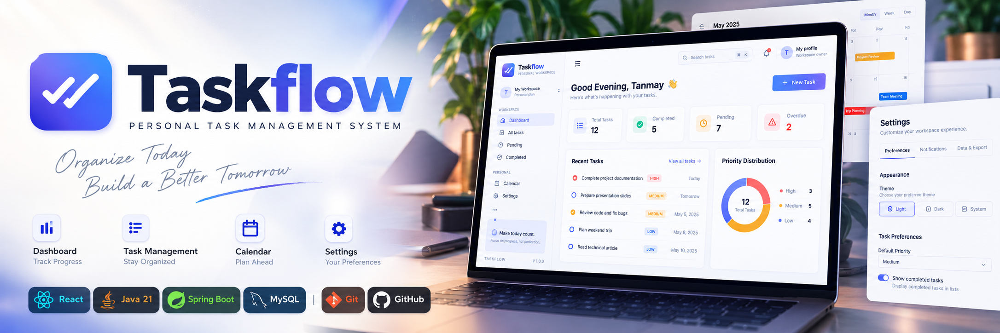
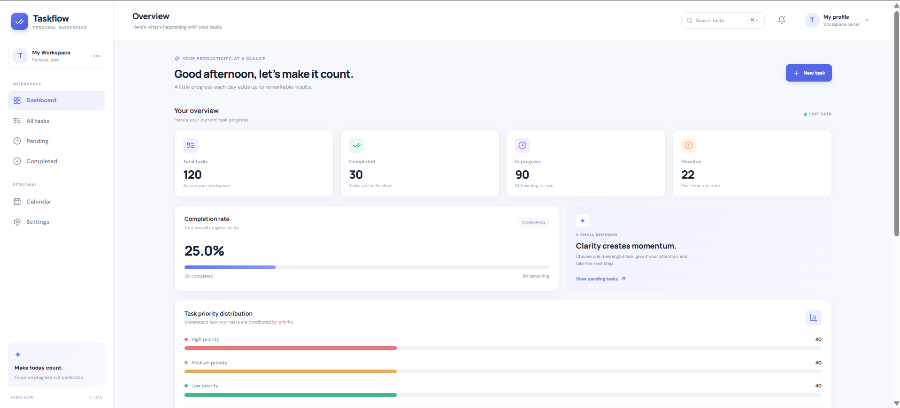
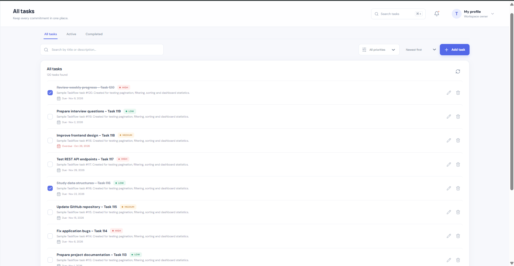
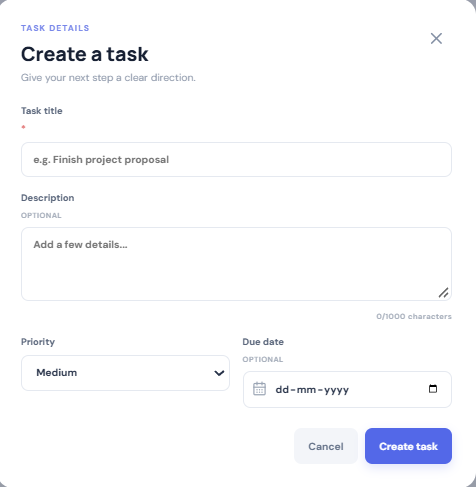
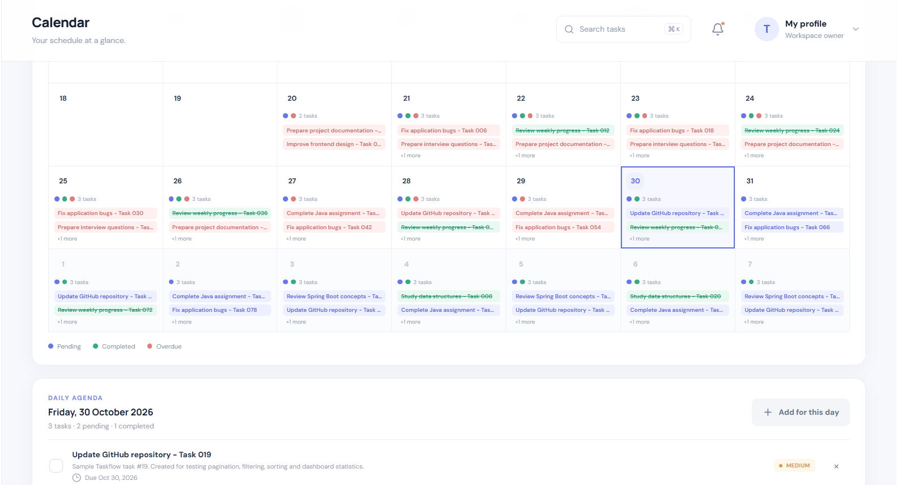
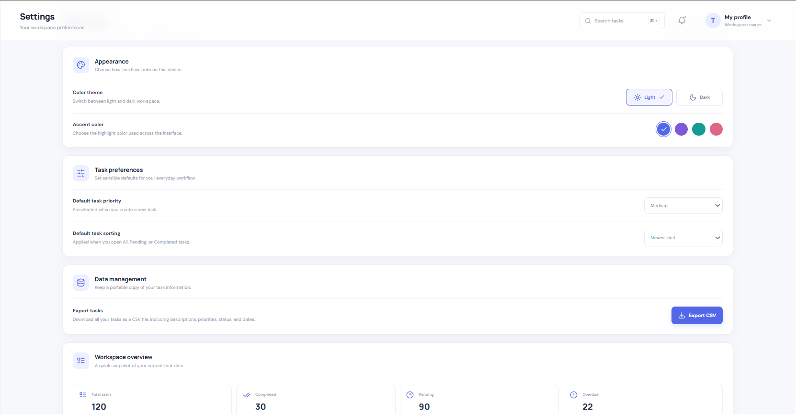

<p align="center">
  
</p>

---

# 🚀 Taskflow — Full-Stack Task Management System

<p align="center">
  
</p>

<p align="center">
  A modern full-stack task management application built with <strong>React</strong>, <strong>Spring Boot</strong>, and <strong>MySQL</strong>.
  <br>
  Organize tasks, manage priorities, track progress, and stay productive through an intuitive dashboard and calendar interface.
</p>

<p align="center">
  
  
  
  
</p>

<p align="center">
  
  
  
  
</p>

---

# 📖 Overview

**Taskflow** is a full-stack task management application designed to simplify daily task organization and productivity tracking.

The application combines a responsive React frontend with a Spring Boot REST API and MySQL database to provide an integrated task management experience.

Users can create and manage tasks, assign priorities, set due dates, track completion status, search and filter records, and monitor their overall progress through an interactive dashboard.

Taskflow follows a layered backend architecture and a component-based frontend structure, demonstrating practical implementation of modern full-stack development concepts.

---

# ✨ Key Features

<table>
<tr>
<td width="50%" valign="top">

### 📊 Interactive Dashboard

- Overview of total tasks
- Completed and pending task statistics
- Overdue task tracking
- Completion progress visualization
- Recent task overview

</td>
<td width="50%" valign="top">

### 📝 Task Management

- Create new tasks
- View task details
- Update existing tasks
- Delete tasks
- Mark tasks as completed
- Reopen completed tasks

</td>
</tr>
<tr>
<td width="50%" valign="top">

### 🔍 Search & Organization

- Search tasks by title and description
- Filter tasks by priority
- Filter by completion status
- Sort tasks by supported fields
- Pagination for task records

</td>
<td width="50%" valign="top">

### 📅 Calendar & Productivity

- Calendar-based task visualization
- Due-date-oriented task organization
- Separate pending and completed views
- Task progress tracking

</td>
</tr>
<tr>
<td width="50%" valign="top">

### ⚙️ Application Settings

- Manage available application preferences
- Configure task-related display preferences
- Export task records

</td>
<td width="50%" valign="top">

### 🎨 User Interface

- Modern dashboard layout
- Reusable React components
- Responsive page structure
- Loading and feedback states
- Interactive navigation and controls

</td>
</tr>
</table>

---

# 🔄 How It Works

Taskflow follows a client-server architecture in which the React frontend communicates with the Spring Boot backend through RESTful APIs.

```text
┌─────────────────────────────────────┐
│            React Frontend           │
│                                     │
│  Dashboard | Tasks | Calendar       │
│  Settings | Search | Filters        │
└──────────────────┬──────────────────┘
                   │
                   │ HTTP Requests / JSON
                   ▼
┌─────────────────────────────────────┐
│          Spring Boot Backend        │
│                                     │
│  REST Controllers                   │
│  Service Layer                      │
│  Repository Layer                   │
│  Validation & Exception Handling    │
└──────────────────┬──────────────────┘
                   │
                   │ JPA / Hibernate
                   ▼
┌─────────────────────────────────────┐
│             MySQL Database          │
│                                     │
│              Task Records           │
└─────────────────────────────────────┘
```

### Application Workflow

| Stage | Description |
|---|---|
| 🖥️ Frontend | Users interact with the application through React components and pages. |
| 📡 API Communication | Axios sends HTTP requests to the Spring Boot REST API. |
| 🎮 Controller Layer | Controllers receive requests and handle API endpoints. |
| ⚙️ Service Layer | Business logic and task operations are processed. |
| 🗄️ Repository Layer | Spring Data JPA handles database operations. |
| 💾 Database | MySQL stores and retrieves task records. |
| 📊 Response | The backend returns JSON responses to update the frontend. |

---

# 📸 Application Screenshots

The following screenshots demonstrate the major interfaces and functionalities of Taskflow.

<p align="center">
  
</p>

<p align="center">
  <b>📊 Interactive Dashboard</b>
  <br>
  Overview of task statistics, progress, and productivity.
</p>

---

| All Tasks | Task Management |
|:---:|:---:|
|  |  |
| **📝 All Tasks** | **➕ Create / Edit Task** |

---

<p align="center">
  
</p>

<p align="center">
  <b>📅 Calendar View</b>
  <br>
  Visualize and organize tasks based on their due dates.
</p>

---

<p align="center">
  
</p>

<p align="center">
  <b>⚙️ Application Settings</b>
  <br>
  Manage application preferences and available settings.
</p>

---

# 🛠️ Technology Stack

Taskflow combines modern frontend technologies, Java backend development, and relational database management to deliver a complete full-stack application.

### 🎨 Frontend

<p>
  
  
  
  
  
  
</p>

### ⚙️ Backend

<p>
  
  
  
  
  
</p>

### 🗄️ Database

<p>
  
</p>

### 🛠️ Tools & Platforms

<p>
  
  
  
  
  
</p>

---

# 📂 Project Structure

```text
Taskflow/
│
├── taskflow-frontend/
│   │
│   ├── public/
│   │
│   ├── src/
│   │   ├── components/
│   │   ├── context/
│   │   ├── pages/
│   │   ├── services/
│   │   ├── styles.css
│   │   └── utils/
│   │
│   ├── .env.example
│   ├── package.json
│   └── vite.config.js
│
├── taskflow-backend/
│   │
│   ├── src/
│   │   ├── main/
│   │   │   ├── java/
│   │   │   │   └── com/taskflow/taskflow_backend/
│   │   │   │       ├── config/
│   │   │   │       ├── controller/
│   │   │   │       ├── dto/
│   │   │   │       ├── entity/
│   │   │   │       ├── enums/
│   │   │   │       ├── exception/
│   │   │   │       ├── repository/
│   │   │   │       └── service/
│   │   │   │
│   │   │   └── resources/
│   │   │
│   │   └── test/
│   │
│   └── pom.xml
│
├── assets/
│   ├── GIF/
│   │   └── GIF.gif
│   │
│   └── screenshots/
│       ├── All_Tasks.png
│       ├── Calendar.png
│       ├── Dashboard.png
│       ├── Settings.png
│       └── Task_Modal.png
│
└── README.md
```

---

# 📁 Directory Overview

| Directory | Purpose |
|---|---|
| **taskflow-frontend/** | React frontend application |
| **src/components/** | Reusable UI components |
| **src/context/** | Shared application contexts and state |
| **src/pages/** | Dashboard, Tasks, Calendar, and Settings pages |
| **src/services/** | Axios API configuration and task service methods |
| **src/utils/** | Utility functions and helper modules |
| **taskflow-backend/** | Spring Boot backend application |
| **controller/** | REST API request handling |
| **dto/** | Request and response data transfer objects |
| **entity/** | JPA entity classes |
| **repository/** | Spring Data JPA database access |
| **service/** | Application business logic |
| **exception/** | Exception handling |
| **config/** | Backend configuration |
| **assets/** | Application GIF and screenshots |

---

# ⚙️ Installation & Setup

Follow these steps to run Taskflow locally.

## 1️⃣ Prerequisites

Make sure the following tools are installed:

- Java Development Kit (JDK) 21
- Node.js and npm
- MySQL Server
- Git
- Maven (optional if using the included Maven Wrapper)

---

## 2️⃣ Clone the Repository

```bash
git clone <YOUR_GITHUB_REPOSITORY_URL>
```

```bash
cd Taskflow
```

---

## 3️⃣ Configure the MySQL Database

Start your MySQL server and create the database:

```sql
CREATE DATABASE taskflow_db;
```

The backend uses environment variables for database configuration.

---

## 4️⃣ Run the Spring Boot Backend

Navigate to the backend directory:

```bash
cd taskflow-backend
```

Configure the database credentials.

### Windows PowerShell

```powershell
$env:DB_URL="jdbc:mysql://localhost:3306/taskflow_db?createDatabaseIfNotExist=true"
$env:DB_USERNAME="root"
$env:DB_PASSWORD="YOUR_MYSQL_PASSWORD"
```

### Linux / macOS

```bash
export DB_URL="jdbc:mysql://localhost:3306/taskflow_db?createDatabaseIfNotExist=true"
export DB_USERNAME="root"
export DB_PASSWORD="YOUR_MYSQL_PASSWORD"
```

Run the application:

### Windows

```bash
.\mvnw.cmd spring-boot:run
```

### Linux / macOS

```bash
./mvnw spring-boot:run
```

The backend will start at:

```text
http://localhost:8080
```

---

## 5️⃣ Run the React Frontend

Open another terminal and navigate to the frontend directory:

```bash
cd taskflow-frontend
```

Install dependencies:

```bash
npm install
```

Create a `.env` file in the frontend root directory:

```env
VITE_API_BASE_URL=http://localhost:8080/api/v1
```

Start the development server:

```bash
npm run dev
```

Open the local URL displayed by Vite, usually:

```text
http://localhost:5173
```

---

# 🔗 REST API Endpoints

The backend exposes RESTful endpoints for task management.

**Base URL:**

```text
http://localhost:8080/api/v1
```

| HTTP Method | Endpoint | Description |
|---|---|---|
| `POST` | `/tasks` | Create a new task |
| `GET` | `/tasks` | Retrieve tasks with filtering and pagination |
| `GET` | `/tasks/{id}` | Retrieve a task by ID |
| `PUT` | `/tasks/{id}` | Update task details |
| `PATCH` | `/tasks/{id}/completion` | Update task completion status |
| `DELETE` | `/tasks/{id}` | Delete a task |
| `GET` | `/tasks/stats` | Retrieve dashboard statistics |

### 🔍 Supported Query Parameters

The task retrieval endpoint supports:

| Parameter | Purpose |
|---|---|
| `search` | Search task titles and descriptions |
| `priority` | Filter by task priority |
| `completed` | Filter by completion status |
| `sortBy` | Select a supported sorting field |
| `direction` | Ascending or descending order |
| `page` | Select the page number |
| `size` | Set the number of records per page |

### 📑 API Documentation

The backend uses Springdoc OpenAPI for API documentation.

When the backend is running, access Swagger UI at:

```text
http://localhost:8080/swagger-ui/index.html
```

---

# 🔐 Known Limitations

- JWT-based authentication and authorization are not implemented in the current version.
- User registration and login are not currently available.
- Tasks are not isolated by individual user accounts.
- The current application is intended for local demonstration and learning, not as a publicly exposed multi-user service.
- Production deployment and production database migration are not yet included.

---

# 🚀 Future Enhancements

| Enhancement | Description |
|---|---|
| 🔐 Authentication | Implement Spring Security and JWT-based authentication |
| 👤 User Management | Add registration, login, and user-specific task ownership |
| 🧪 Testing | Expand automated frontend and backend test coverage |
| ☁️ Deployment | Deploy the frontend and backend with production database configuration |
| 🔔 Notifications | Introduce task reminders and due-date notifications |

---

# 🎯 Learning Outcomes

Through Taskflow, the project demonstrates practical implementation of:

- Component-based frontend development using React.
- REST API development using Spring Boot.
- Layered architecture in Java applications.
- Database integration using Spring Data JPA and Hibernate.
- MySQL database design and CRUD operations.
- API communication using Axios.
- Search, filtering, sorting, and pagination.
- Frontend-backend integration.
- Application state management and user interface design.

---

# 👨‍💻 Author

<p align="center">
  <b>Tanmay Tawade</b>
  <br>
  Java Full Stack Developer | React | Spring Boot
</p>

<p align="center">
  <a href="https://github.com/TanmayT134">
    
  </a>
  <a href="https://www.linkedin.com/in/tanmay-tawade-995829344/">
    
  </a>
  <a href="https://portfolio-tanmay-tawade.vercel.app/">
    
  </a>
</p>

---

<p align="center">
  ⭐ If you find this project interesting, consider giving it a star!
</p>